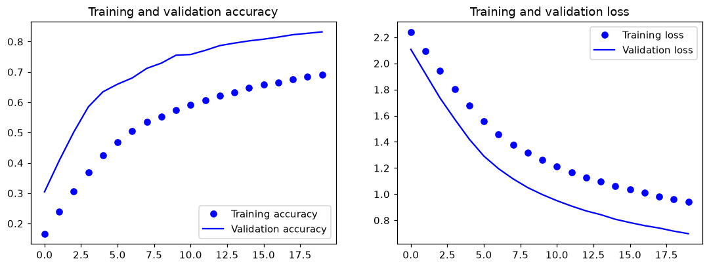
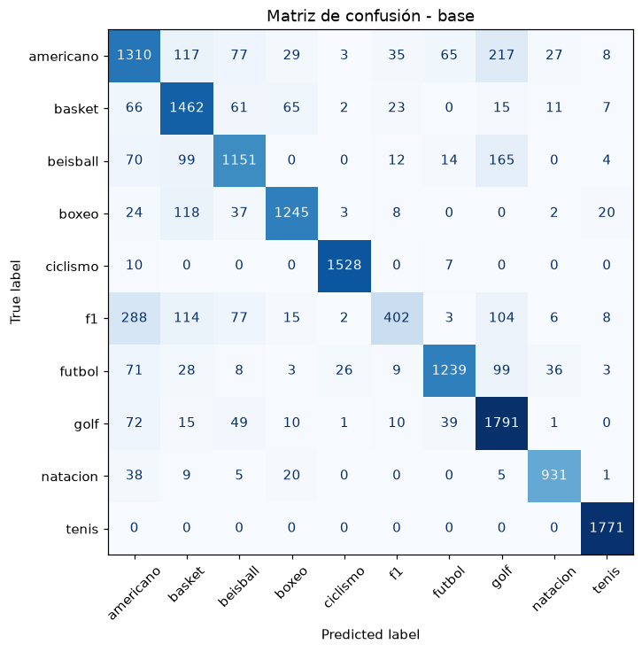
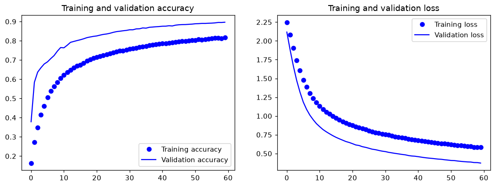
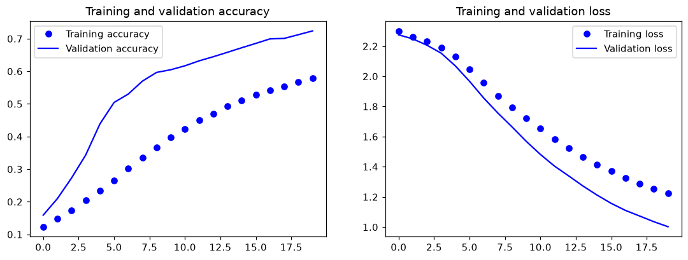
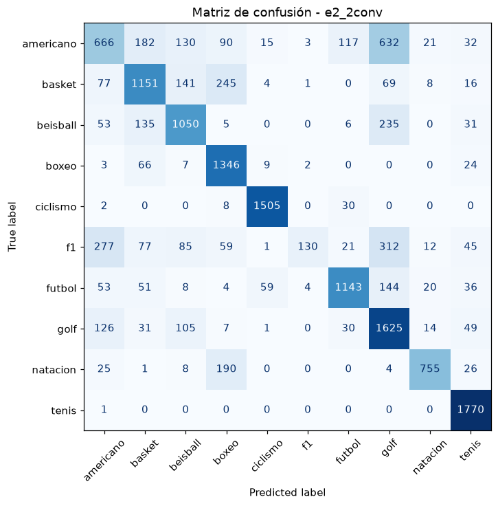
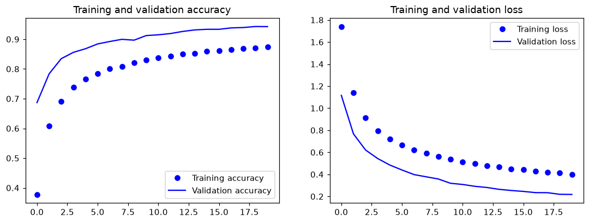
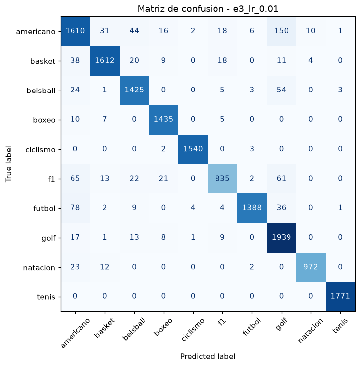
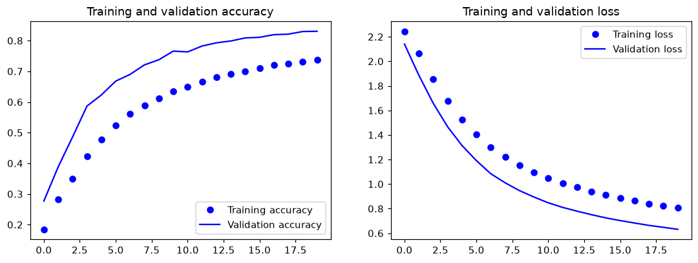
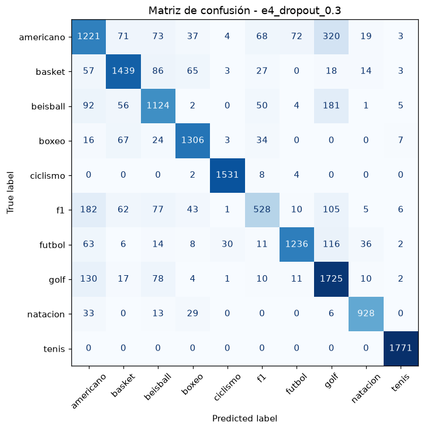
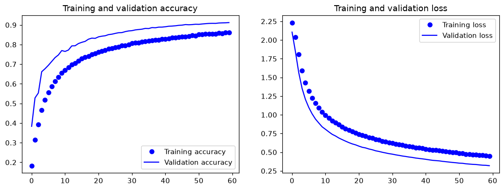

# CNN para clasificación de imágenes deportivas

## 1. Dataset

Imágenes de 21×28 píxeles a color, una carpeta por deporte.

| Deporte | Imágenes | % del total |
|---|---|---|
| americano | 9,348 | 12.1 % |
| basket | 8,823 | 11.4 % |
| beisball | 7,752 | 10.1 % |
| boxeo | 7,125 | 9.2 % |
| ciclismo | 7,533 | 9.8 % |
| f1 | 5,053 | 6.6 % |
| futbol | 7,617 | 9.9 % |
| golf | 9,768 | 12.7 % |
| natacion | 5,172 | 6.7 % |
| tenis | 8,937 | 11.6 % |
| **Total** | **77,128** | 100 % |

El desbalance es leve: golf (la clase más grande) tiene unas 1.9 veces las imágenes de f1 (la más pequeña). División igual en todos los experimentos (semilla 42): 80 % entrenamiento y 20 % prueba (15,426 imágenes); del entrenamiento se separa otro 20 % para validación.

## 2. Configuración

**Modelo base** (el del ejercicio original): `Conv2D` (32 filtros, 3×3) → `LeakyReLU(0.1)` → `MaxPooling 2×2` → `Dropout(0.5)` → `Flatten` → `Dense(32)` → `LeakyReLU` → `Dropout(0.5)` → `Dense(10, softmax)`. Optimizador SGD con learning rate 0.001, batch de 64, pérdida `categorical_crossentropy`, 20 épocas.

| Experimento | Qué se cambió | Parámetros |
|---|---|---|
| Base | Nada, es la referencia | 158,954 |
| E1 · 60 épocas | 60 épocas en vez de 20 | 158,954 |
| E2 · 2 capas conv | Segundo bloque de convolución (64 filtros) | 105,770 |
| E3 · Learning rate 0.01 | Learning rate 0.01 en vez de 0.001 | 158,954 |
| E4 · Dropout 0.3 | Dropout 0.3 en vez de 0.5 | 158,954 |
| E5 · 60 épocas + Dropout 0.3 | Las modificaciones de E1 y E4 juntas | 158,954 |

*E2 tiene menos parámetros que la base porque cada `MaxPooling` reduce el mapa que entra a la capa densa.*

## 3. Resumen

La **precisión total (accuracy)** - porcentaje de fotos de prueba que la red acertó.

| Experimento | Accuracy | F1 macro | f1 (prec / recall) | Americano (prec / recall) | Entrenamiento / validación final |
|---|---|---|---|---|---|
| Base | 83.2 % | 0.822 | 0.81 / 0.39 | 0.67 / 0.69 | 0.69 / 0.83 |
| E1 · 60 épocas | 89.6 % | 0.892 | 0.79 / 0.63 | 0.74 / 0.78 | 0.82 / 0.90 |
| E2 · 2 capas conv | 72.2 % | 0.696 | 0.93 / 0.13 | 0.52 / 0.35 | 0.58 / 0.72 |
| E3 · Learning rate 0.01 | 94.2 % | 0.942 | 0.93 / 0.82 | 0.86 / 0.85 | 0.87 / 0.94 |
| E4 · Dropout 0.3 | 83.0 % | 0.827 | 0.72 / 0.52 | 0.68 / 0.65 | 0.74 / 0.83 |
| E5 · 60 épocas + Dropout 0.3 | 91.4 % | 0.914 | 0.87 / 0.74 | 0.77 / 0.81 | 0.86 / 0.91 |

Orden de mejor a peor: **E3 (94.2 %) > E5 (91.4 %) > E1 (89.6 %) > Base (83.2 %) ≈ E4 (83.0 %) > E2 (72.2 %)**.

## 4. Experimentos

En cada tabla, la precisión indica qué proporción de las veces que la red dice un deporte tiene razón, y el recall, qué proporción de las fotos reales de ese deporte logra encontrar. El F1 resume las dos. Las fotos reales son el tamaño de cada deporte en el conjunto de prueba y no cambian entre experimentos. Para clasificar cada deporte con los cuatro casos de la p. 80 del libro consideré alto un valor de 80 % o más.

### Base

| Deporte | Precisión | Recall | F1 | Fotos reales |
|---|---|---|---|---|
| americano | 67 % | 69 % | 68 % | 1,888 |
| basket | 75 % | 85 % | 80 % | 1,712 |
| beisball | 79 % | 76 % | 77 % | 1,515 |
| boxeo | 90 % | 85 % | 88 % | 1,457 |
| ciclismo | 98 % | 99 % | 98 % | 1,545 |
| f1 | 81 % | 39 % | 53 % | 1,019 |
| futbol | 91 % | 81 % | 86 % | 1,522 |
| golf | 75 % | 90 % | 82 % | 1,988 |
| natacion | 92 % | 92 % | 92 % | 1,009 |
| tenis | 97 % | 100 % | 99 % | 1,771 |

La base es la referencia y acierta el 83.2 % de las fotos de prueba. Cinco deportes salen bien en precisión y en recall: boxeo, ciclismo, futbol, natación y tenis. El caso que más llama la atención es f1: cuando la red dice f1 tiene razón el 81 % de las veces, pero solo encuentra el 39 % de sus 1,019 fotos, es decir, alta precisión con bajo recall. Basket y golf van al revés, con un recall alto (85 % y 90 %) pero una precisión de 75 % en los dos, porque la red los usa de comodín: golf se predijo 2,396 veces teniendo 1,988 fotos reales. Americano (67 % de precisión y 69 % de recall) y beisbol (79 % y 76 %) no llegan al 80 % en ninguna de las dos métricas.

En las curvas el entrenamiento termina en 69 % y la validación en 83 %. La validación va arriba porque el Dropout solo se apaga al validar, y lo importante es que las dos líneas siguen subiendo cuando acaba la época 20: a la red le faltó tiempo. La matriz deja ver el comodín del que hablaba arriba, porque la columna de golf es la más cargada, con 217 fotos de americano y 165 de beisbol clasificadas como golf.

### E1 · 60 épocas

| Deporte | Precisión | Recall | F1 | Fotos reales |
|---|---|---|---|---|
| americano | 74 % | 78 % | 76 % | 1,888 |
| basket | 92 % | 92 % | 92 % | 1,712 |
| beisball | 87 % | 86 % | 87 % | 1,515 |
| boxeo | 94 % | 95 % | 95 % | 1,457 |
| ciclismo | 98 % | 99 % | 98 % | 1,545 |
| f1 | 79 % | 63 % | 70 % | 1,019 |
| futbol | 96 % | 88 % | 92 % | 1,522 |
| golf | 84 % | 94 % | 89 % | 1,988 |
| natacion | 93 % | 96 % | 95 % | 1,009 |
| tenis | 99 % | 100 % | 100 % | 1,771 |

Con 60 épocas el accuracy sube a 89.6 %, 6.4 puntos más que la base. Ocho deportes quedan en alta precisión y alto recall, y basket y golf dejan de ser comodines. Quedan atrás americano (74 % de precisión y 78 % de recall) y f1 (79 % y 63 %); este último está a un punto de alcanzar el 80 % de precisión. Aun así f1 mejoró bastante: encuentra el 63 % de sus fotos contra el 39 % de la base, aunque a 208 de ellas todavía las confunde con americano.

El entrenamiento llega a 82 % y la validación a 90 %, y en las últimas 10 épocas la validación ganó menos de un punto, así que la curva ya casi se aplana: pasar de 20 a 60 épocas rindió, pero seguir subiendo daría poco. En la matriz, la confusión de americano hacia golf bajó de 217 fotos en la base a 150.

### E2 · 2 capas conv

| Deporte | Precisión | Recall | F1 | Fotos reales |
|---|---|---|---|---|
| americano | 52 % | 35 % | 42 % | 1,888 |
| basket | 68 % | 67 % | 68 % | 1,712 |
| beisball | 68 % | 69 % | 69 % | 1,515 |
| boxeo | 69 % | 92 % | 79 % | 1,457 |
| ciclismo | 94 % | 97 % | 96 % | 1,545 |
| f1 | 93 % | 13 % | 22 % | 1,019 |
| futbol | 85 % | 75 % | 80 % | 1,522 |
| golf | 54 % | 82 % | 65 % | 1,988 |
| natacion | 91 % | 75 % | 82 % | 1,009 |
| tenis | 87 % | 100 % | 93 % | 1,771 |

Agregar un segundo bloque convolucional empeoró el resultado: 72.2 %, once puntos por debajo de la base. Solo ciclismo y tenis siguen en alta precisión y alto recall. El caso más extremo es f1, con 93 % de precisión y apenas 13 % de recall: la red casi nunca elige f1 (lo predijo 140 veces teniendo 1,019 fotos reales), pero cuando lo hace acierta. Futbol (85 % y 75 %) y natación (91 % y 75 %) terminan igual, con buena precisión y recall bajo. Boxeo (69 % de precisión y 92 % de recall) y golf (54 % y 82 %) pasan al caso contrario, y americano (52 % y 35 %), basket (68 % y 67 %) y beisbol (68 % y 69 %) fallan en ambas métricas.

El entrenamiento termina en 58 % y la validación en 72 %, las dos todavía subiendo, lo que sugiere que la red más profunda aprende más lento y 20 épocas se quedan cortas. No probé con más épocas, así que no sé hasta dónde llegaría. La matriz muestra a golf absorbiendo todo: se predijo 3,021 veces (1,988 reales) y le llegaron 632 fotos de americano y 312 de f1.

### E3 · Learning rate 0.01

| Deporte | Precisión | Recall | F1 | Fotos reales |
|---|---|---|---|---|
| americano | 86 % | 85 % | 86 % | 1,888 |
| basket | 96 % | 94 % | 95 % | 1,712 |
| beisball | 93 % | 94 % | 94 % | 1,515 |
| boxeo | 96 % | 98 % | 97 % | 1,457 |
| ciclismo | 100 % | 100 % | 100 % | 1,545 |
| f1 | 93 % | 82 % | 87 % | 1,019 |
| futbol | 99 % | 91 % | 95 % | 1,522 |
| golf | 86 % | 98 % | 91 % | 1,988 |
| natacion | 99 % | 96 % | 97 % | 1,009 |
| tenis | 100 % | 100 % | 100 % | 1,771 |

Subir el learning rate a 0.01 fue el cambio más efectivo: 94.2 % de aciertos, 11 puntos por encima de la base con las mismas 20 épocas. Los diez deportes quedan en alta precisión y alto recall. Los más bajos son americano (86 % de precisión y 85 % de recall) y f1 (93 % y 82 %), pero f1 pasó de encontrar el 39 % de sus fotos a encontrar el 82 %. Golf es el de menor precisión (86 %) aunque tiene 98 % de recall, o sea que todavía recibe algunas fotos ajenas.

Entrenamiento y validación terminan en 87 % y 94 %. La distancia entre ellas se redujo a 7 puntos, contra los 14 de la base, y las curvas suben mucho más rápido que en el resto de los experimentos. En la matriz casi todo cae en la diagonal; la confusión más grande es americano hacia golf, con 150 fotos.

### E4 · Dropout 0.3

| Deporte | Precisión | Recall | F1 | Fotos reales |
|---|---|---|---|---|
| americano | 68 % | 65 % | 66 % | 1,888 |
| basket | 84 % | 84 % | 84 % | 1,712 |
| beisball | 75 % | 74 % | 75 % | 1,515 |
| boxeo | 87 % | 90 % | 88 % | 1,457 |
| ciclismo | 97 % | 99 % | 98 % | 1,545 |
| f1 | 72 % | 52 % | 60 % | 1,019 |
| futbol | 92 % | 81 % | 86 % | 1,522 |
| golf | 70 % | 87 % | 77 % | 1,988 |
| natacion | 92 % | 92 % | 92 % | 1,009 |
| tenis | 98 % | 100 % | 99 % | 1,771 |

Bajar el Dropout a 0.3 casi no movió el accuracy: 83.0 % contra 83.2 % de la base, una diferencia que cae dentro de la variación normal entre experimentos. Lo que sí cambió es quién falla. Basket se une a los deportes bien resueltos (84 % y 84 %), hasta seis en total. Golf sigue con baja precisión (70 %) y alto recall (87 %), y americano (68 % y 65 %), beisbol (75 % y 74 %) y f1 (72 % y 52 %) quedan bajos en ambas. En f1 el recall subió de 39 % a 52 %, pero su precisión bajó de 81 % a 72 %.

El entrenamiento llega a 74 % y la validación a 83 %, y las curvas siguen subiendo al terminar, de modo que la red sigue corta de entrenamiento. En la matriz, americano hacia golf subió a 320 fotos, más que las 217 de la base.

### E5 · 60 épocas + Dropout 0.3

| Deporte | Precisión | Recall | F1 | Fotos reales |
|---|---|---|---|---|
| americano | 77 % | 81 % | 79 % | 1,888 |
| basket | 94 % | 92 % | 93 % | 1,712 |
| beisball | 89 % | 86 % | 87 % | 1,515 |
| boxeo | 96 % | 96 % | 96 % | 1,457 |
| ciclismo | 99 % | 100 % | 99 % | 1,545 |
| f1 | 87 % | 74 % | 80 % | 1,019 |
| futbol | 97 % | 90 % | 93 % | 1,522 |
| golf | 84 % | 94 % | 89 % | 1,988 |
| natacion | 97 % | 96 % | 97 % | 1,009 |
| tenis | 99 % | 100 % | 100 % | 1,771 |

Combinar 60 épocas con Dropout 0.3 da 91.4 %, mejor que cada cambio por separado (89.6 % con las épocas solas y 83.0 % con el Dropout solo) pero por debajo del learning rate de E3. Ocho deportes quedan en alta precisión y alto recall. De los dos restantes, f1 tiene precisión alta (87 %) y recall bajo (74 %), mientras que americano va al revés, con precisión baja (77 %) y recall alto (81 %): recibe fotos de otros deportes, entre ellas 129 de f1.

Entrenamiento y validación terminan en 86 % y 91 %, la distancia más corta de todos los experimentos (5 puntos), señal de que la red aprendió sin desbalancearse. En la matriz las confusiones mayores son americano hacia golf (150), f1 hacia americano (129) y beisbol hacia golf (90).

## 5. Cómo se reparten los deportes en los cuatro casos

La p. 80 del libro propone mirar cada clase según si su precisión y su recall son altos o bajos. Para tenerlo todo en una sola vista, la tabla resume en qué caso cae cada deporte en cada experimento, con las letras AA (alta precisión y alto recall), AB (alta precisión y bajo recall), BA (baja precisión y alto recall) y BB (baja en ambas), usando 80 % como límite.

| Deporte | Base | E1 | E2 | E3 | E4 | E5 |
|---|---|---|---|---|---|---|
| americano | BB | BB | BB | AA | BB | BA |
| basket | BA | AA | BB | AA | AA | AA |
| beisball | BB | AA | BB | AA | BB | AA |
| boxeo | AA | AA | BA | AA | AA | AA |
| ciclismo | AA | AA | AA | AA | AA | AA |
| f1 | AB | BB | AB | AA | BB | AB |
| futbol | AA | AA | AB | AA | AA | AA |
| golf | BA | AA | BA | AA | BA | AA |
| natacion | AA | AA | AB | AA | AA | AA |
| tenis | AA | AA | AA | AA | AA | AA |
| **Deportes en AA** | **5** | **8** | **2** | **10** | **6** | **8** |

Lo primero que se ve es que ciclismo y tenis están en AA en los seis experimentos, mientras que americano solo llega a AA en E3. La base tiene cinco deportes en AA, E1 y E5 ocho, E4 seis, y E2 apenas dos. E3 es el único en el que los diez quedan en AA.

Los casos intermedios son los más informativos. f1 aparece en AB en la base, en E2 y en E5: la red casi no se equivoca cuando elige f1, pero se le escapan fotos, y en E2 llega al extremo de encontrar solo el 13 % de ellas. Golf aparece en BA en la base, E2 y E4, y es la otra cara de lo mismo: como se predice más de lo que existe, buena parte de lo que americano y beisbol pierden termina en golf. Americano pasa por BB en cuatro de los seis experimentos, la peor casilla; solo en E5 sube a BA y en E3 a AA.

Esto sirve también para matizar lo que el libro dice del desbalance. Si el problema fuera la cantidad de fotos, las clases más pequeñas serían las más afectadas, y f1 (6.6 % del total) sí lo es. Pero natación, casi igual de pequeña (6.7 %), está en AA en cinco de los seis experimentos y solo se cae en E2, mientras que americano y golf, que están entre las más grandes, aparecen en BB y BA. Con un desbalance de solo 1.9 a 1, me parece que pesa más lo parecidas que son las fotos entre ciertos deportes que la cantidad de ejemplos.

El libro también advierte que el accuracy por sí solo puede dar una idea falsa del modelo. Un ejemplo claro en estos experimentos: la base y E4 acertaron casi lo mismo (83.2 % y 83.0 %), pero en E4 el recall de f1 subió de 39 % a 52 % y la precisión de golf bajó de 75 % a 70 %. El número global no registró ese cambio y la tabla por deporte sí.

## 6. Conclusiones

Lo que más rindió fue hacer que la red aprendiera más rápido, y no hacerla más grande. Con el learning rate en 0.01, E3 llegó a 94.2 % en las mismas 20 épocas, más que triplicando las épocas (E1, 89.6 %). Aun así las épocas ayudan, porque la base seguía mejorando cuando se detuvo, y combinadas con un Dropout menor (E5, 91.4 %) dieron un poco más que solas; ese Dropout por sí mismo no movió el resultado (E4).

Agregar una capa convolucional sin cambiar nada más fue contraproducente: E2 bajó a 72.2 %. Sus curvas todavía subían al terminar, por lo que la explicación más probable es que necesita más entrenamiento y no que dos capas sean peores, aunque eso no se comprobó. En todos los casos, los errores se concentran en americano, f1, golf y beisbol, y esos son los deportes que hay que vigilar aunque el accuracy suba.

## 7. Alcance de estos resultados

Cada configuración se corrió una sola vez, así que diferencias de uno o dos puntos, como la de E4 contra la base o la de E5 contra E1 no son concluyentes. Los tiempos de entrenamiento tampoco sirven para comparar, porque la computadora tuvo carga distinta (E1 y E5, con 60 épocas cada una, tardaron 734 y 235 segundos). E2 solo se probó con 20 épocas. Y la idea de que americano, golf y beisbol se confunden porque comparten campos verdes es una suposición.
